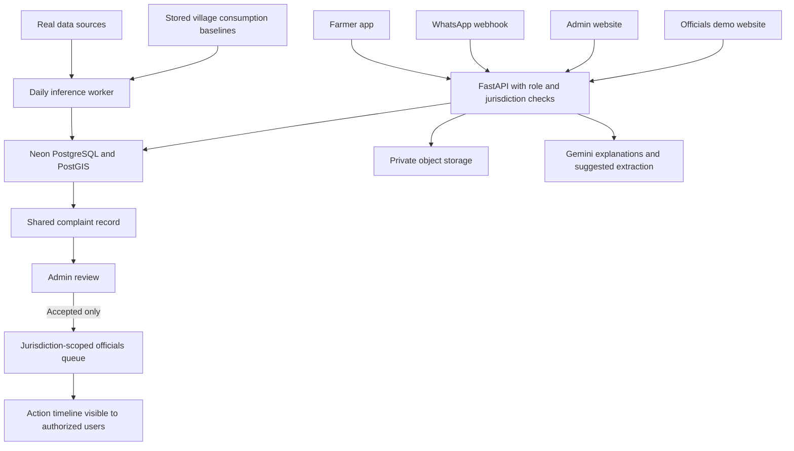

# JalSathi — Product Requirements Document

Version: 0.1, review draft  
Prepared: 29 October 2026  
Basis: supplied hackathon presentation, existing personal prototype, and subsequent product decisions in this conversation.

This document describes the intended product. A capability listed here is not a claim that it already exists. Confirmed decisions, implementation recommendations, and unresolved choices are separated at the end.

## 1. Product purpose

JalSathi helps Maharashtra farmers understand local water stress, estimate crop irrigation needs, access market and scheme information, and report water-related problems. Administrators inspect complaints, source data, model performance and village estimates. Accepted complaints appear in a separate officials' demonstration portal for acknowledgement and action tracking.

The prediction system refreshes daily and presents rolling next-7-day and next-15-day summaries. Statewide coverage is an engineering target of approximately 50,000 village records; prediction availability and precision depend on local evidence. Maharashtra's official village directory displayed 44,929 villages when checked on 29 October 2026. The directory must be imported and versioned rather than hard-coding this count. [Village directory](https://mahavillages.mahabhumi.gov.in/all_list.php)

## 2. Four product surfaces

| Surface | Primary user | Responsibility |
|---|---|---|
| Farmer mobile app | Farmers | Farm profiles, understandable water information, planning, markets, schemes, Marathi assistance, complaints and tracking |
| Admin website | JalSathi administrators/reviewers | Complaint review, village baselines, data quality, models, estimates, routing and audit history |
| Officials' demo website | Demonstration official accounts | Only admin-accepted complaints, jurisdiction views, acknowledgement and action updates |
| WhatsApp number | People reporting water problems | Complaint intake and relevant complaint-status communication without requiring the app |

These surfaces use one FastAPI service and shared records. They must not maintain conflicting copies of complaints. The officials' site is a demonstration of a proposed workflow; it is not an integrated government grievance service. Demonstration actions must be clearly identified.



## 3. Roles and access

- Farmer: access own farms, own complaints and published local information.
- Admin/reviewer: inspect complaints and estimates within assigned scope; accept, reject, request information or mark duplicates; maintain authorized baseline records.
- Official-demo user: see accepted complaints assigned to their jurisdiction; acknowledge and record actions. Cannot inspect rejected or unreviewed submissions through any endpoint.
- System administrator: manage roles, geographic assignments, integration configuration and model release permissions.
- WhatsApp reporter: submit and track their own ticket after appropriate identity verification. A WhatsApp sender is not automatically a verified farmer, landowner or app account.

FastAPI enforces ownership, role and geographic access. Hiding a page or button is not authorization. Official/admin roles are invitation-based; ordinary registration cannot select a privileged role.

## 4. Architecture and recommended stack

| Layer | Choice | Purpose |
|---|---|---|
| Farmer app | React Native + Expo + TypeScript | Mobile UI, localization, device attachment/location access and cached views |
| Admin and officials' sites | React + TypeScript | Separate routes/deployments using shared components and API types |
| Application API | FastAPI, Pydantic, SQLAlchemy, Alembic | Validation, authorization, complaints, calculations, data access and integrations |
| Database | Neon PostgreSQL + PostGIS | Relational records, village boundaries, station mapping and spatial queries |
| Authentication | Neon Auth, subject to mobile integration verification | Shared identities; authorization remains in our application |
| File storage | Neon Object Storage where available for the selected project/region | Private complaint attachments, source snapshots and model artifacts |
| Numerical prediction | Python + XGBoost initially | Forecast source conditions from validated numerical features |
| Language AI | Gemini through the backend | Marathi/English explanations and optional structured complaint extraction |
| Background processing | Separate Python worker; durable job/outbox tables in PostgreSQL initially | Daily ingestion/inference, integration retries and notification delivery |
| WhatsApp | WhatsApp Business Platform / Cloud API | Official message/webhook integration for the designated number |

FastAPI is recommended: the existing numerical work is Python, and the same service can validate inputs and serve results. Heavy inference and ingestion run in a separate worker, not in a user's HTTP request. FastAPI's own guidance distinguishes heavy computation from small response background tasks. [FastAPI](https://fastapi.tiangolo.com/tutorial/background-tasks/)

Neon's current documentation lists managed auth, PostGIS and S3-style object storage. Files belong in object storage; PostgreSQL stores their keys, ownership, hashes and metadata. Validate region availability, supported operations and signed uploads before committing deployment configuration. An S3-compatible storage adapter permits a replacement if necessary. [Auth](https://neon.com/docs/auth/overview), [PostGIS](https://neon.com/docs/extensions/postgis), [Object Storage](https://neon.com/docs/storage/overview)

Neon's documented phone plugin currently signs in existing users with linked numbers, requires an external SMS provider, and does not provide phone-first signup. Do not promise farmer phone registration from Neon alone. For the first demo, invited accounts or email/OAuth are the proposed default. Validate React Native sessions, account creation/linking and recovery before selecting production phone onboarding. [Phone authentication](https://neon.com/docs/auth/guides/plugins/phone-number)

Proposed repository layout:

```text
apps/farmer-mobile
apps/admin-web
apps/officials-demo-web
services/api
services/worker
packages/api-types
packages/shared-domain
```

Share contracts, units, translations where practical and calculation definitions; mobile and web screens need not share UI implementation.

## 5. Farmer app: pages and behavior

| Page | Features | How it works |
|---|---|---|
| Language, account and village | Marathi/English, sign-in, official village selection | Resolve LGD village ID; show district/taluka to disambiguate names. Device location can suggest a village but cannot silently establish land ownership or source connectivity. |
| Home / local water outlook | 7/15-day switch, water-stress outlook, forecast availability, latest source date, relevant advisories | Read the latest completed published forecast snapshot. Explain whether it is area-level, station-supported or unavailable. |
| My farms | Multiple farm profiles with crop, area, sowing date and irrigation method | Save farmer-reported fields with units and dates. Farm coordinates and village association must be explicit. |
| Irrigation planning | Crop stage, estimated daily irrigation, 7/15-day totals, units, assumptions and applicable reviewed constraints | Use weather and crop-water formulas. Clearly distinguish estimated requirement, permitted application and known supply. |
| Markets / economics | Actual mandi quotes, market/date/variety/unit filters, crop comparisons and optional economics scenario | Fetch MSAMB; optionally AGMARKNET with the user's key. Margin requires explicit yield, price, cost and transport assumptions. Quotes are not harvest-price forecasts. |
| Schemes and notices | Official scheme links, source passages, dates and reviewed local notices | Retrieve official material; explain relevant text. Do not automatically certify subsidy eligibility or legal applicability. |
| Marathi assistant | Marathi/English questions, explanations, citations and data dates | Retrieve approved numerical outputs and official evidence, then ask Gemini to explain. Display unavailable evidence honestly; use labelled evidence-only fallback on provider failure. |
| Report a problem | Water-shortage, supply interruption, irrigation-water issue, leakage or related water complaint; text, photo and village/location | Create one complaint ticket. Required location and description can be completed before submission. Reporter can review and submit the final content. |
| My complaints | Ticket list, review state, official-demo progress, requests for information and response history | Show the backend event timeline. An accepted complaint is not necessarily resolved. |
| Settings | Language, profile corrections, privacy/consent and notification preferences | Maintain account and channel preferences; show last successful synchronization. |

Offline recommendation: cache last successful readings/plans and allow local complaint drafts. A draft is not submitted until the server acknowledges it. Use persistent local storage, with secure credential storage separately. [Expo SQLite](https://docs.expo.dev/versions/latest/sdk/sqlite/)

Retain the original deck's crop planning, markets, government evidence and Marathi assistant scope. Farmer screens present understandable results and assumptions; detailed research metrics remain accessible to administrators. The existing personal research prototype can retain its extensive on-screen metrics.

## 6. Admin website: pages and behavior

| Page | Required content and actions |
|---|---|
| Overview | Complaint counts by review/service state, geographic filters, data freshness, batch status and model release status |
| Complaint inbox | Combined app/WhatsApp submissions; village, category, date, source and priority filters; incomplete-location queue |
| Complaint review | Original message and attachments, editable normalized fields, event history, duplicate suggestions; accept/reject/request information/merge with reasons |
| Accepted complaints and routing | Jurisdiction assignment, officials' portal publication state, handoff attempts and service progress |
| Village registry and maps | Village IDs/boundaries, watershed/aquifer, linked stations and verified supply schemes; mapping provenance and gaps |
| Consumption baselines | Import/edit/version per-village approximate daily consumption; uses covered, reference period, method, reviewer and uncertainty |
| Water estimates | Daily, 7-day and 15-day demand, supply where supported, unmet requirement, input assumptions and component breakdown |
| Model lab | Model versions, feature schema, training period, chronological and geographic evaluation, errors, baselines, uncertainty and release gates |
| Sources and data flow | Source → validation → features → forecast → budget → published output; raw samples, units, station identity, gaps, staleness and retrieval errors |
| Schemes / notices / markets | Source refresh status, official evidence and reviewed applicability; original market units and quote dates |
| AI quality and operations | Evidence retrieval, Marathi evaluation, actual usage/latency, failure counts and redacted errors |
| Jobs, access and audit | Forecast runs, integration retries, account jurisdictions, baseline changes, model promotion and complaint transitions |

Accepted complaint priority can consider the report and available evidence, but must be reviewed. Complaint count, AI-extracted severity and predicted water stress are separate indicators; none independently verifies a drought event.

## 7. Officials' demonstration website

Pages:

1. Sign-in and assigned jurisdiction.
2. Accepted-complaint queue, with village/category/age/service-state filters.
3. Complaint detail: sanitized report, approved evidence, admin note and relevant dated village outlook.
4. Action timeline: acknowledge, assign, mark in progress, request clarification or record resolution with a note/evidence.
5. Jurisdiction summary: accepted complaint totals and action progress.

The official-demo API returns only authorized accepted records and subsequent service updates. It excludes raw private inboxes, rejected reports, credentials, unrestricted attachments and unnecessary personal details. Individual location/contact disclosure must have a defined purpose and access scope.

Both websites can use the same database. Acceptance makes a complaint eligible for the officials' query, so a second database is unnecessary. An outbox records publication/notification events atomically with acceptance. For a future independent official system, add a separate authenticated connector, retries and external acknowledgement; do not claim one exists in this demo.

## 8. Complaint lifecycle and WhatsApp

Review state and service state are separate:

```text
App or WhatsApp
    → draft / awaiting location or details
    → submitted
    → admin review
        → needs information → resubmitted
        → rejected, with reason
        → duplicate, linked to canonical ticket
        → accepted → visible to assigned official-demo users
                        → pending acknowledgement
                        → acknowledged / assigned
                        → in progress
                        → resolved
```

An authorized reviewer may reopen a resolved case with a reason. If an accepted case is withdrawn or corrected, retain the history and remove/restrict its active publication appropriately. Status changes use version checks to avoid two reviewers overwriting each other.

WhatsApp intake:

1. Reporter messages the designated business number.
2. Meta delivers a signed webhook to FastAPI; verify authenticity and deduplicate by provider message ID before processing.
3. Save original text and attachment references. Ask for village/district or a location pin when missing; sender phone number does not establish the village.
4. Optionally use Gemini to suggest category, a Marathi/English summary and structured fields. Preserve the original; validate and confirm uncertain fields. Gemini cannot accept, reject or dispatch the complaint.
5. Submit a ticket and return its reference/status through the permitted channel. Provider errors are recorded and retried without duplicating the ticket.
6. Admin reviews the same record shown for app submissions.
7. Accepted records appear in the officials' portal; action updates return through the shared complaint timeline and authorized notifications.

Use the WhatsApp Business Platform rather than automating a personal WhatsApp session. Message sending must follow the current platform policy, including the customer-service window, applicable approved templates and consent requirements. Text outside an allowed reply window must not be assumed deliverable as a free-form message. [WhatsApp policy](https://business.whatsapp.com/policy), [Business Platform](https://business.whatsapp.com/products/business-platform)

This PRD authorizes design of the integration, not sending messages to real people during document preparation. A real number/account and credentials must be provisioned for live implementation. Audio transcription is not assumed in this version; unsupported media must receive a clear handling path.

## 9. Prediction and estimation outputs

JalSathi must distinguish three kinds of output:

| Output | Meaning | Release condition |
|---|---|---|
| Area water-stress outlook | Weather/soil-moisture indicators relative to the location's historical conditions | Validate indicator definitions and spatial resolution; distinguish calculated indicators from trained forecasts |
| Groundwater forecast | Daily predicted depth below ground level and uncertainty through eligible horizons | Fresh, compatible station observations and a model that passes validation |
| Water budget / shortage estimate | Estimated demand compared with supported deliverable supply, including storage timing where known | Valid sector coverage, comparable units, verified source links and documented supply inputs |

Daily predictions cover days 1–15. The 7-day summary uses days 1–7; the 15-day summary uses days 1–15. They are overlapping periods, not 22 days. Aggregate daily volumes; do not simply add or average groundwater depths. Display the latest issue time, input observation dates, model version and availability status.

Where supply evidence is insufficient, publish estimated consumption/demand and water-stress information, with shortage volume marked unavailable. Groundwater depth, reservoir elevation, tap coverage and storage capacity alone cannot establish daily village supply in litres. This corrects any overly broad interpretation of the earlier statewide-shortage discussion.

## 10. Reusable approximate village consumption

Confirmed approach: establish a per-village daily baseline once, store it, and reuse it in daily 7/15-day calculations. It is approximate and versioned, not a fresh daily measurement.

Required baseline fields:

```text
village_id, sector, litres_per_day, method,
reference_start/end, source, recorded_at, valid_from/to,
uses_covered, uncertainty/assumptions, reviewer, version
```

Methods:

- Historical delivery/usage records over a representative period, if available.
- Tank balance using opening volume + measured inflows − closing volume, with losses/other outflows identified. Label delivery/outflow estimates accurately.
- A population or other normative requirement estimate when observations are absent. Label it as an estimated requirement, not measured consumption.

Baseline scenarios may use `7 × daily baseline` and `15 × daily baseline`. If adjustments are applied, total the adjusted daily values instead. Do not treat overlapping periods as additive.

Keep household, agriculture, livestock and other-use components separate. Population and livestock counts change occasionally; crops, growth stages, rain and irrigation practices make agricultural requirements seasonal. Reuse a household baseline until reviewed, but do not silently freeze agricultural demand for the whole year. Review dates and expiry rules are proposed configuration, not already agreed policy.

Do not sum a total-use baseline with its component estimates again. Do not add registered-farm consumption to a village total that already includes those farms. Registered farmers alone do not represent all village agriculture. A supply-restricted day's observed use must not be interpreted as proof that the village needed no more water.

The JJM household service benchmark can support a normative domestic estimate; it is not observed consumption and does not cover all agricultural needs. [JJM guidance](https://jaljeevanmission.gov.in/sites/default/files/guideline/JJM_Operational_Guidelines.pdf)

## 11. Supply and farm calculations

Supply estimation requires a verified connection between village and source, seasonal source yield or allocation, delivery constraints, known outages and usable storage. A nearby reservoir is not automatically a supplier; shared reservoirs cannot be allocated in full to every village. Source well extraction yield and groundwater depth are different quantities.

For a daily storage-aware budget, simulate inflows, usable stored volume, delivery capacity, demand and remaining storage in time order. Report unmet demand and its dates. If only constant supply assumptions are available, label the output as a scenario. Do not infer continuous adequate service from a positive 15-day total.

Farm-water calculation, retaining the prototype's transparent approach:

```text
ETc = crop-stage Kc × reference ET0
Net irrigation = max(0, ETc − effective rain − applicable soil-water contribution)
Gross irrigation depth = net irrigation / application efficiency
Volume (m³) = depth (mm) × cultivated area (ha) × 10
Volume (litres) = volume (m³) × 1,000
```

Unmeasured soil-water contribution must be explicitly omitted or assumed; it is not an observation. Crop coefficients, effective rain and efficiency assumptions need agronomy review. Reviewed allocations/constraints can cap application but cannot reduce biological crop demand. Keep unmet requirement visible. [FAO crop coefficients](https://www.fao.org/4/x0490e/x0490e0b.htm), [FAO irrigation need](https://www.fao.org/4/S2022E/s2022e08.htm)

## 12. Daily operation versus training

Daily production operation performs inference with the approved trained version. It does not retrain 50,000 village models or retrain daily.

```text
Scheduled worker
  → fetch/cache newly available observations and forecasts
  → validate identity, units, dates, coverage and availability
  → prepare location-specific feature rows
  → load approved model once per worker
  → predict in batches
  → read stored village baselines; calculate daily budgets
  → summarize next 7 / next 15 days
  → publish completed versioned snapshots
  → apps/websites read stored results
```

Reuse weather downloads across villages sharing source grid cells. Fetching 50,000 separate requests is not a requirement. Store both village and weather-grid IDs so the UI cannot imply measurement precision that the source lacks. Map wells by stable source IDs, geography and aquifer suitability, not names alone or only nearest distance.

Rows with missing mandatory inputs are marked unsupported; do not fabricate levels or future observations. A daily job does not make a stale source fresh. Preserve prior snapshots with their age; partial failures must not be labelled complete statewide coverage. Use locks, retries, checkpoints and idempotent run keys.

Initial model development pools historical location/date examples; compare shared and regional models. Use location-specific historical baselines. Evaluate chronologically and on held-out geographic groups, with separation appropriate to the maximum 15-day target horizon. Archived forecast inputs must reflect what was available at issue time, not realized future weather. Seasonal/manual groundwater records must not be presented as daily measured training labels.

The existing prototype has seven direct XGBoost horizons, not a validated statewide 15-day model. Extending the horizon or feature schema requires initial training and validation before freezing an approved inference version. Automatic periodic retraining is outside this version's requirements.

The prototype's fixed-lead archived rainfall inputs currently cover days 1–7. Days 8–15 require a verified issue-time forecast archive or an explicitly validated alternative feature design. Do not extend a seven-day weather total, fill future observations, or silently extrapolate it and claim a validated 15-day model.

Metrics: per-horizon MAE/RMSE, persistence skill, uncertainty coverage/width, critical-event recall and false alerts where labels exist, geographic coverage and freshness. Define shortage-event labels separately from groundwater thresholds. Undefined metrics remain unavailable rather than zero. A water-stress heuristic is not an official drought declaration.

## 13. Sources, accessibility and limitations

| Input | Intended source | Availability / handling |
|---|---|---|
| Village identity | Maharashtra LGD village directory | Public listing; retain code crosswalks for Census and renamed/changed boundaries |
| Population | Census PCA plus reviewed local updates/projections | Public village baseline is 2011; label reference year and estimated current values |
| Weather | Open-Meteo history/forecast/archive or approved replacement | Grid data; enforce availability, horizon, terms and rate limits |
| Groundwater | NWIC/GSDA/CGWB records | Monitoring-station coverage and measurement freshness vary; no all-village daily assumption |
| Reservoir context | Verified NWIC/CWC fields | Distinguish elevation, discharge and storage; validate rating curves for conversion |
| Piped-water schemes | JJM Citizen Corner and authorized WSSD/MRSAC exports | Public scheme/coverage information exists; statewide downloadable network and daily flow access remain unverified |
| Consumption baseline | Existing operator/local records or explicit calculation | One-time import then reuse; preserve method and uncertainty |
| Crops | Farmer profiles; authorized crop-survey aggregate exports | Farmer coverage is partial; government plot data is not automatically open |
| Livestock | Livestock Census and reviewed local records | Version by year; validate local granularity |
| Market prices | MSAMB; optional AGMARKNET | Preserve original units, variety, quote date and meaning of reported rate |
| Schemes/notices | MahaDBT, GSDA and other official documents | Retrieve evidence; review local applicability |

References: [Census](https://www.censusindia.gov.in/census.website/en/data/population-finder), [Open-Meteo history](https://open-meteo.com/en/docs/historical-weather-api), [forecast](https://open-meteo.com/en/docs), [previous runs](https://open-meteo.com/en/docs/previous-runs-api), [NWIC Maharashtra groundwater](https://nwdp.nwic.gov.in/dataset/ground-water-level-telemetry-daily-maharashtra-gw), [GSDA monitoring network](https://gsda.maharashtra.gov.in/en-dashboard/), [JJM Citizen Corner](https://ejalshakti.gov.in/jjm/citizen_corner/villageinformation.aspx), [WSSD GIS case study](https://nceg.gov.in/assets/pdf/WSS.pdf), [Digital Crop Survey access](https://www.pib.gov.in/Pressreleaseshare.aspx?PRID=2114889&lang=2&reg=48), [Livestock Census](https://dahd.maharashtra.gov.in/en/publication/20-th-livestock-census/), [MSAMB](https://www.msamb.com/ApmcDetail/APMCPriceInformation), [AGMARKNET](https://data.gov.in/resource/current-daily-price-various-commodities-various-markets-mandi), [MahaDBT](https://mahadbt.maharashtra.gov.in/Farmer/AgriLogin/AgriLogin), [GSDA resolutions](https://gsda.maharashtra.gov.in/en-important-government-resolutions/).

No new physical sensors or recurring manual well-report collection are required by this scope. Existing operational records or a one-time baseline import are allowed. Where supply/usage records cannot be obtained, reduce the claim rather than inventing them.

## 14. Gemini responsibilities

Gemini explains retrieved facts and supports Marathi/English interaction. It can propose structured complaint summaries/categories; backend schemas validate them and reviewers retain authority. Use the same approved numeric results across app, web and assistant rather than allowing AI to recalculate them inconsistently.

Gemini does not generate groundwater measurements, predict numerical supply by itself, verify a complaint, grant a subsidy, issue a government order or update operational states without an authorized deterministic action. External documents and user complaint text are evidence, not instructions to the system.

Keep original sources, citations and calculation assumptions visible. Log model identifier, prompt version, latency and actual usage where returned, without logging secrets. Provide clear fallback for outages. Evaluate Marathi understanding, numerical consistency, citation correctness and unsupported-answer handling. Select an available Gemini model through configuration, rather than assuming the prototype's configured model name is universally supported. [Gemini structured outputs](https://ai.google.dev/gemini-api/docs/structured-output), [API keys](https://ai.google.dev/gemini-api/docs/api-key)

## 15. Logical records

| Records | Essential content |
|---|---|
| User profiles, roles, jurisdictions | Auth identity, role grants, consent and village/geographic access |
| Villages and crosswalks | Official IDs, boundary, coordinates, administrative codes, version |
| Farms and crop seasons | Owner/reporter, geometry/area, crop, sowing date, irrigation method and provenance |
| Stations, sources, schemes, connections | Stable IDs, geometry, source type, units and verified village/source relationships |
| Observations and source fetches | Observed time, received time, raw reference, normalized value and quality flags |
| Baseline versions | Sector, litres/day, method, reference period, assumptions and approval |
| Model versions and evaluations | Artifact key/hash, feature schema, training/evaluation definitions, horizon metrics and release state |
| Forecast runs and daily outputs | Issue date, location, horizon, source/model/baseline version, output and availability |
| Budget summaries | Comparable demand/supply sectors, daily deficits, 7/15-day totals and uncertainty/limitations |
| Complaints, messages and attachments | Reporter/channel, original content, village, reviewed fields, private object keys and consent |
| Complaint events and assignments | Review/service transitions, actor, note, version and jurisdiction |
| Integration outbox and deliveries | Idempotency key, destination, attempts, acknowledgement and sanitized errors |
| Official documents, market quotes and AI traces | Source dates, original units, retrieval evidence and permitted diagnostics |

Use UTC storage with explicit source timezone; display operational dates in Asia/Kolkata. Choose a documented local daily aggregation interval. Avoid persisting every derived feature forever without a retention plan; preserve enough lineage to reproduce released forecasts.

## 16. API contract outline

All routes below belong to FastAPI. The admin website calls them; it does not itself host the authoritative API. Prefix: `/api/v1`. Authentication and role checks apply unless explicitly a provider-verification callback.

| Method / route | Purpose / access |
|---|---|
| `GET /me` | Authenticated profile, roles and jurisdictions |
| `GET /villages` | Search official village directory |
| `GET /villages/{id}/outlook?days=7|15` | Published dated outlook, availability and provenance |
| `GET /villages/{id}/water-budget?days=7|15` | Supported estimate or explicit unavailable components |
| `GET, POST /farms` | Own farm profiles |
| `PATCH /farms/{id}` | Update owned farm/season details |
| `GET /farms/{id}/irrigation-plan?days=7|15` | Estimated farm water requirement |
| `GET /markets`, `GET /schemes` | Dated source-backed content |
| `POST /assistant/messages` | Evidence-grounded explanation with limits |
| `POST /complaints` | App complaint submission with idempotency key |
| `GET /complaints/mine`, `GET /complaints/{id}` | Own complaints or authorized reviewer detail |
| `POST /complaints/{id}/messages` | Authorized clarification/reporter response |
| `POST /uploads/presign` | Scoped private upload; validate limits and finalize metadata |
| `GET /admin/complaints` | Scoped admin review queue |
| `POST /admin/complaints/{id}/review` | Accept/reject/request info/duplicate, reason, expected version and routing |
| `GET /admin/villages/{id}/baselines` | Inspect baseline versions |
| `POST /admin/villages/{id}/baselines` | Create reviewed replacement, not silent overwrite |
| `GET /admin/models`, `/admin/models/{id}/metrics` | Model metadata and evaluation |
| `GET /admin/sources`, `/admin/forecast-runs` | Source quality and job status |
| `POST /admin/forecast-runs` | Authorized inference refresh; returns job ID, not blocking computation |
| `GET /official/complaints` | Accepted, currently publishable, jurisdiction-authorized complaints only |
| `GET /official/complaints/{id}` | Minimized accepted complaint detail |
| `POST /official/complaints/{id}/actions` | Authorized acknowledgement/assignment/progress/resolution |
| `GET /webhooks/whatsapp` | Verify configured provider callback challenge |
| `POST /webhooks/whatsapp` | Verify provider signature, persist message/event and queue processing |

Provider callback verification does not make arbitrary requests trusted. Reject invalid signatures; use replay/idempotency controls. A future external official connector requires its own scoped authentication, contract and delivery receipts. Version the OpenAPI schema and generate compatible TypeScript contracts.

## 17. Reliability, privacy and operating requirements

- All Gemini, database, storage, WhatsApp and optional data-provider secrets stay server-side. Use ignored `.env` locally and managed environment secrets in deployment; no privileged keys in React or React Native bundles.
- Redact private content and credentials from operational logs; store complaint content only in authorized records. Private attachments use scoped temporary access, content-type/size checks and appropriate upload inspection.
- Backend operations validate ownership, role, geographic jurisdiction and allowed transitions. Rate-limit complaint/AI endpoints and deduplicate retried requests.
- Keep raw complaint text and an immutable event history alongside reviewed fields. Changes do not erase the original report.
- Define retention, deletion and consent rules before production. Official-demo accounts receive the minimum necessary reporter information.
- Retried ingestion, messages and handoffs cannot create duplicate forecasts/tickets or silently skip events. The database transaction and outbox must commit together where relevant.
- Foreground API responses read saved results; a failed provider must not block the entire app. Show missing/old evidence and last completed run explicitly.
- Metrics include complaint review duration, acceptance-to-visibility delay, resolution status, webhook duplicates, delivery failures, batch duration, village coverage, stale inputs, model error and AI response quality. Do not claim water saved, crop loss reduced or official response success without measurements.

## 18. Acceptance criteria

1. A farmer can select an unambiguous village, create a farm, inspect a dated 7/15-day view and submit/track a complaint.
2. An authentic WhatsApp report with sufficient details creates exactly one ticket even when the provider retries. Missing village information remains incomplete rather than being guessed.
3. Admin sees both channels in one queue and can request information, reject, mark duplicate or accept with a reason and jurisdiction.
4. Only accepted, publishable cases appear to the relevant official-demo account. Direct API requests cannot expose rejected, pending or other-jurisdiction cases.
5. Official-demo action updates appear in the same complaint timeline. UI clearly distinguishes demonstration progress from an actual government action.
6. Baseline records have units, uses covered, method and date. A daily run reuses the approved version; amendments preserve earlier versions and prior outputs remain reproducible.
7. A daily inference run produces days 1–15 and overlapping 7/15-day summaries for supported locations without retraining. Unsupported outputs carry explicit status/reason.
8. The same source/model/baseline snapshot produces consistent numbers in app, admin and assistant; Gemini cannot invent missing readings.
9. Models that fail baseline, freshness or evidence gates cannot silently become operational recommendations. Fifteen-day performance is evaluated independently of seven-day performance.
10. Daily tank balances include refills; groundwater-level changes are not treated as litres consumed; demand and supply sectors are comparable.
11. Load-test a representative 1,000-village job, then the full approximately 50,000-record workload. Report download, feature, inference, write and total time separately. Earlier runtime estimates are unbenchmarked planning estimates, not service guarantees.
12. Marathi usability, numerical explanations, source citations, authorization boundaries and complaint retry behavior pass explicit end-to-end checks before demonstration sign-off.

## 19. Delivery sequence and present implementation

Suggested implementation order:

1. Shared database/auth/storage foundation, roles, village registry and app/web shells.
2. App complaint → admin review → officials' demo action workflow, including private attachments and audit history.
3. Live WhatsApp webhook/number integration with deduplication and controlled status communication.
4. Baseline imports, daily budgets, source ingestion and visible data-flow/model diagnostics.
5. Validated 15-day inference, farm planning, markets, schemes and Gemini integration across the farmer experience.
6. Geographic expansion, operational benchmarks, data agreements and end-to-end validation.

The ordering is a recommendation; all listed agreed product areas remain in scope. Complaint development need not wait for a validated drought model.

Current prototype at `E:\Z-PROJECTS\JalSathi` already contains a React research dashboard and FastAPI backend, public source ingestion, seven-horizon groundwater experimentation, farm calculations, actual market reports, official-document retrieval, optional Gemini and extensive visible diagnostics. It runs locally with SQLite; optional PostgreSQL/PostGIS configuration is present but is not a completed Neon migration.

It does not establish a deployed farmer mobile app, production auth, shared complaint lifecycle, official handoff, WhatsApp integration, complete statewide baseline database or validated statewide 15-day forecasts. The pilot groundwater evaluation failed to beat persistence and had stale observations; it must not be presented as a released statewide predictor. The current station-name filter also needs stable-ID/geographic disambiguation before expansion.

## 20. Decisions carried forward and open items

### Confirmed user decisions

1. Build a fresh farmer app, an admin website, a separate officials' demo website and a WhatsApp complaint number.
2. Keep all farmer-facing project functions in the app, including the original farm-planning, market, scheme and Marathi-assistance scope.
3. Admin reviews complaints; accepted complaints proceed to the officials' demonstration workflow through backend endpoints.
4. Use React for web, React Native for mobile, FastAPI as the proposed Python backend, Neon for database/auth/storage where compatible, and Gemini for language AI.
5. Use real sources and APIs; keep keys in environment configuration. Do not fabricate observations, scores or prices.
6. Support rolling next-7-day and next-15-day views, refreshed by daily inference using a trained model; daily retraining is not required.
7. Plan for all Maharashtra villages, approximately 50,000 records, using location-specific inputs rather than one station's data copied statewide.
8. Establish approximate village consumption baselines once and reuse them, with their assumptions/reference dates retained.
9. Keep detailed model, source and estimation metrics visible in the admin/research experience.
10. The existing prototype is a personal explanatory tool; the officials' site is explicitly a demonstration, not an already connected government system.

### Recommended implementation choices, not prior user commitments

- Expo/TypeScript, PostGIS, separate durable worker, private object storage and a shared API/database.
- Version baselines and forecasts; keep household/agricultural sectors separate; review seasonal changes.
- Preserve raw complaint evidence, use explicit review/service states, jurisdiction-scoped official views and transactional outbox events.
- Use Gemini for explanation/optional extraction only; human reviewers accept complaints and numerical services produce water estimates.
- Release statewide water-stress/consumption information before claiming unsupported shortage volumes or precise village groundwater forecasts.

### Outstanding decisions and external dependencies

- First pilot villages/districts and responsible demo jurisdictions.
- Farmer signup/login method and validated Neon Auth mobile flow; external SMS provider if phone OTP is selected.
- Neon region/project feature access, deployment hosts, attachment limits and retention policy.
- WhatsApp business account, number/provider, credentials and message-template setup.
- Source and method for first baseline imports, sectors covered, uncertainty bounds and review/expiry policy.
- Access to aggregate crop records, verified scheme/source links, local allocations and existing flow/tank records.
- Definitions of actionable thresholds, shortage-event labels and model release criteria after validation.
- Any future real government-system API agreement; none is assumed by the demo.

These items do not prevent reviewing this PRD or building the shared complaint workflow. They limit which live integrations and forecast claims can be enabled.
